# Adversarial ML Lab: attacking and hardening a network intrusion detector

A PyTorch intrusion detector trained on UNSW-NB15, attacked the way a real adversary would attack it
(evasion with traffic that stays valid, training-data poisoning with a backdoor, a malicious model file),
then hardened and shipped through a signed, scanned, gated model supply chain.

[](https://github.com/benalifathia08-source/Adversarial-ML-Lab/actions/workflows/ci.yml)
 
 

> **TL;DR**
> - Textbook attacks fool the detector 100% of the time, but **none of their outputs are real traffic**. An attacker who owns
>   both ends and fakes replies evades it **61%** of the time; a backdoor needs only **0.1%** poisoned training data.
> - Standard poisoning detectors failed here; a **5% trusted dataset + data-validation check** cut the backdoor from 90% to 1.7%.
> - The model only ships if it is **signed, scanned and robust**: the gate rejected 2 of 3 candidates; the released one holds
>   at **0% evasion** on the untouched test set.

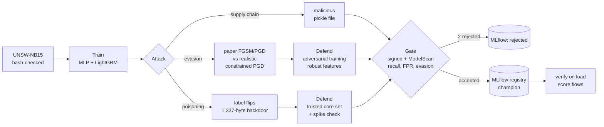

Try it in one command (verifies the signed model, scores real flows, then tries the strongest realistic evasion):

```bash
python -m advml.score --sample 4 --attack
```

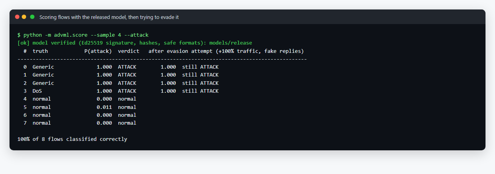

## Results at a glance

| Question | Answer (validation split unless noted) |
|---|---|
| Do textbook attacks (FGSM, PGD) fool the model? | Yes, 100% of the time, but **0% of their outputs are real network flows** |
| Can an attacker who only pads their own traffic evade it? | Barely: **2.6%** of detected attacks with +100% traffic |
| An attacker who owns both ends (C2, exfiltration) and fakes replies? | Yes: **46% at +25% traffic, 61% at +100%**; 68% against LightGBM in black-box mode |
| How much poison does a backdoor need? | **140 rows (0.1% of training data) → 63%** of triggered attacks pass; 1% → 90%. Clean accuracy does not move |
| Do standard poisoning detectors catch it? | No. ART activation clustering, spectral signatures and a cross-validated label check all fail (backdoor still 81–90%) |
| What works? | A **5% trusted core set + a frequency-spike check**: 100% of the poison removed, backdoor **90% → 1.7%** (the trigger alone gets 1.3% on a clean model) |
| Evasion defenses? | Adversarial training: 61% → **0.1%**, but false positives 12% → 17%. Dropping attacker-controlled features: **0%**, false positives 11% |
| Which model ships? | The one the gate accepts: signed, ModelScan-clean, recall ≥ 95%, false positives ≤ 15%, evasion ≤ 15% → **robust-features model** |
| Does it hold on the official test set (used once)? | Evasion **0%** (baseline 65%). Recall 97.1%, but false positives rise to 28.8% because the test set's normal traffic differs (see Limitations) |
| Malicious model file? | `torch.load(weights_only=False)` runs the payload; `weights_only=True` refuses; ModelScan flags it **CRITICAL**; the signed loader refuses it |

## The threat model is the point

Most adversarial-ML results on network data change any feature by a small amount. A real attacker cannot change
the sensor's connection counters, the protocol, or the replies of a server they do not own, and every change must
keep the flow arithmetically consistent (`smean = sbytes / spkts`, `rate = (spkts + dpkts - 1) / dur`, packets of
28–1,504 bytes). This lab implements two realistic attackers in [`attacks.py`](src/advml/attacks.py):

| Attacker | Can change | Typical case |
|---|---|---|
| **One-sided** | bytes, packets, duration and jitter of what they send, **only upwards** (padding, extra packets, delays) | attacking someone else's server |
| **Both ends** | the same, for both directions, including **fake replies** where there were none | C2 or exfiltration to a server the attacker owns |

Every adversarial flow is rounded to integers, recomputed, and checked by an independent validator before it
counts. Budgets are "add up to *b* × the current amount" (for a missing reply direction, *b* × the request side).

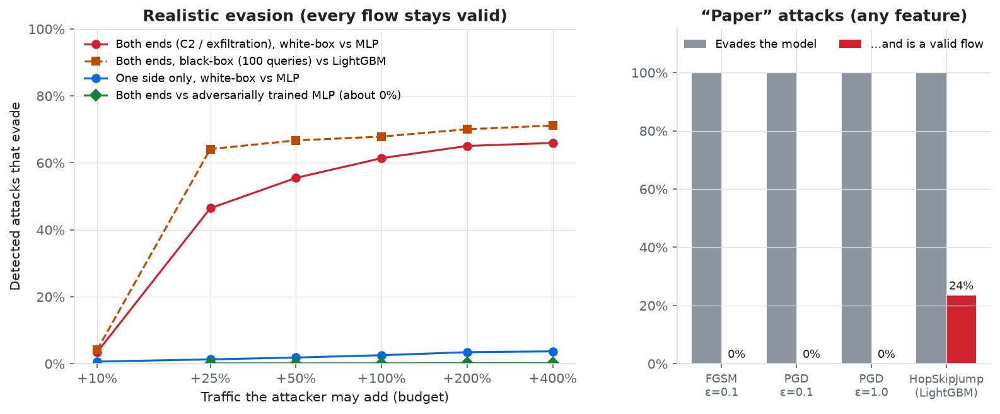

Why fake replies work so well: 66% of detected attacks have **no reply packets at all**, and reply-side features
carry about half of the model's permutation importance.

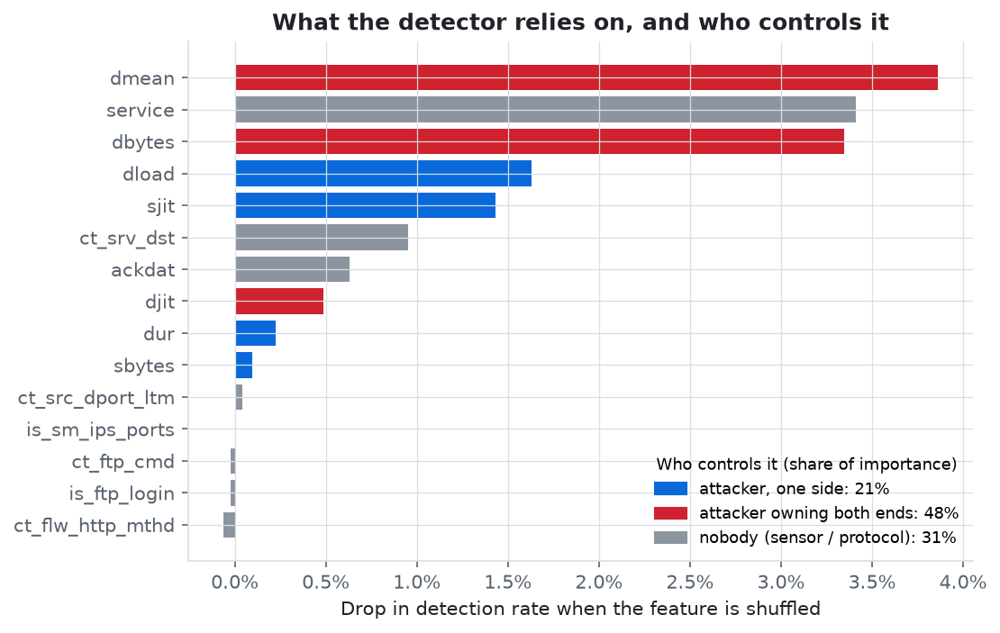

## Poisoning

The backdoor trigger is something an attacker can actually send: every packet they send padded to exactly 1,337
bytes. On a clean model, the trigger alone changes almost nothing (1.3%). Triggered copies of attack flows, labelled
"normal", are slipped into the training data:

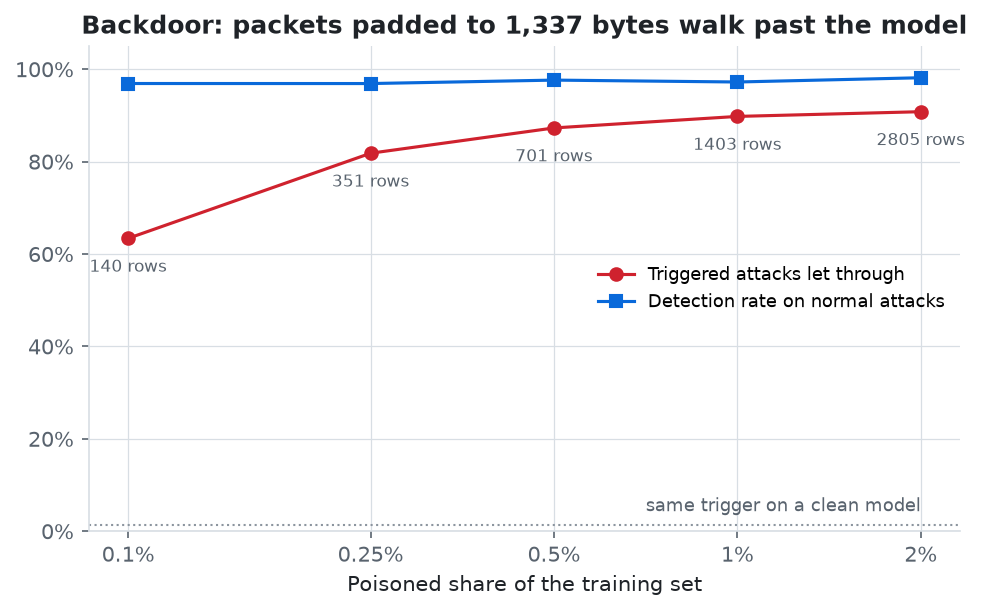

The usual detectors work in the model's embedding space, where a backdoored model has, by definition, placed the
poison next to normal traffic. They fail here. What works is defense in depth with data the attacker cannot touch:

1. **Trusted core set**: a model trained only on 5% verified data flags rows whose label it strongly disagrees
   with (catches 92% of the poison, and 92% of a targeted label-flipping attack).
2. **Frequency-spike check** against the trusted snapshot: an exact value that suddenly becomes far more common in
   one class (the trigger has to repeat to work). 0 false alarms on clean data.

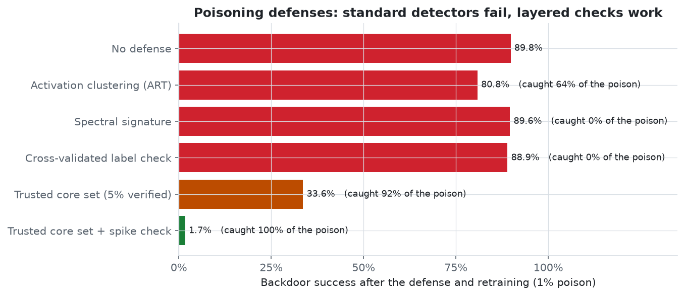

## Evasion defenses

Each defense is attacked again by an attacker who knows it (white-box, 60 steps, 3 restarts) and in black-box mode.

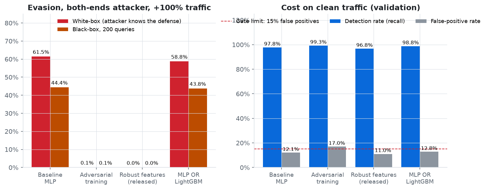

- **Adversarial training** with the constrained attack works (0.1%) but costs false positives (17%), so the gate
  rejects it.
- **Robust features**: the model never sees the 14 features a both-ends attacker controls. Evasion is 0% under these
  threat models *by construction*, with the lowest false-positive rate. It is only as good as the threat model:
  an attacker who can also shape the sensor's connection counters (`ct_*`) is out of scope.
- **Ensemble (MLP OR LightGBM)** does not help: the evasions transfer (59%).

## Model supply chain

| Control | Implementation |
|---|---|
| No code in model files | weights in **safetensors**, everything else JSON; preprocessing stored as JSON, never pickle |
| Scan | **ModelScan** on every candidate, in the gate and in CI |
| Integrity and origin | **Ed25519-signed manifest** with the SHA-256 of every file, the dataset hashes and the git commit; [`load_verified`](src/advml/supply_chain.py) refuses anything that does not match |
| Promotion | gate: signature + scan + recall ≥ 95% + false positives ≤ 15% + evasion ≤ 15% → MLflow registry, alias `champion` |
| CI | lint, 40 tests, and `python -m advml.verify models/release --gate` on every push; actions pinned to commit SHAs |

<p>
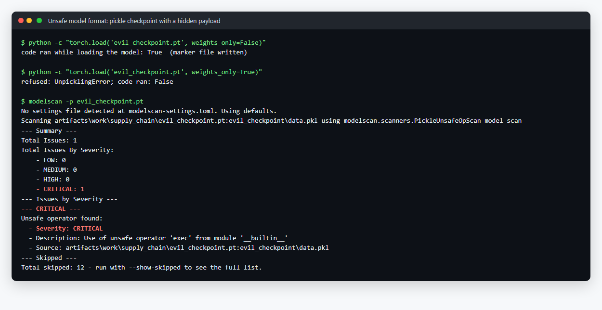
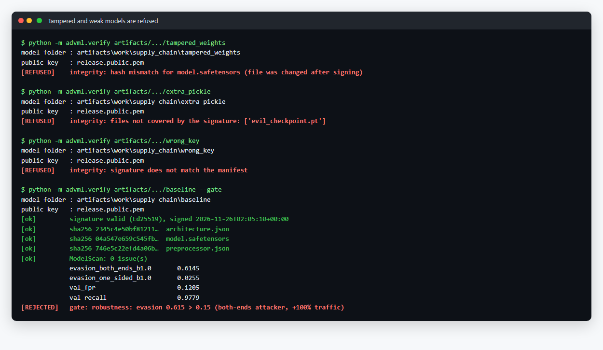
</p>
<p>
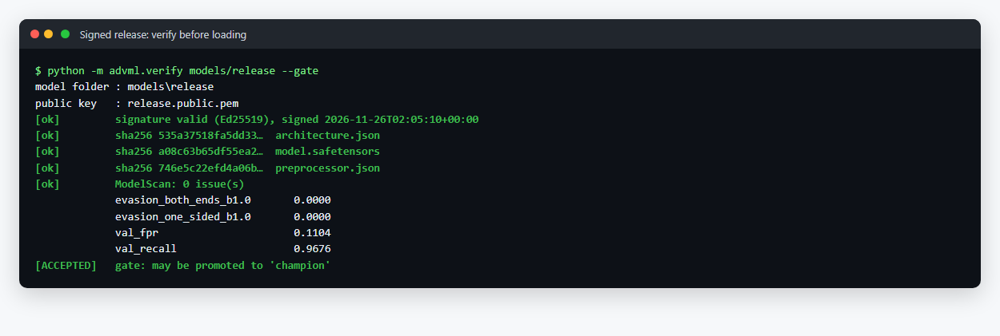
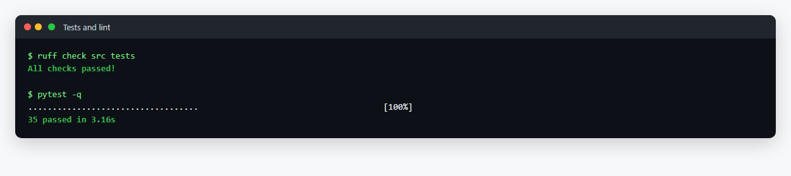
</p>

MLflow tracks every run; only the gate-approved model is registered and gets the `champion` alias:

<p>
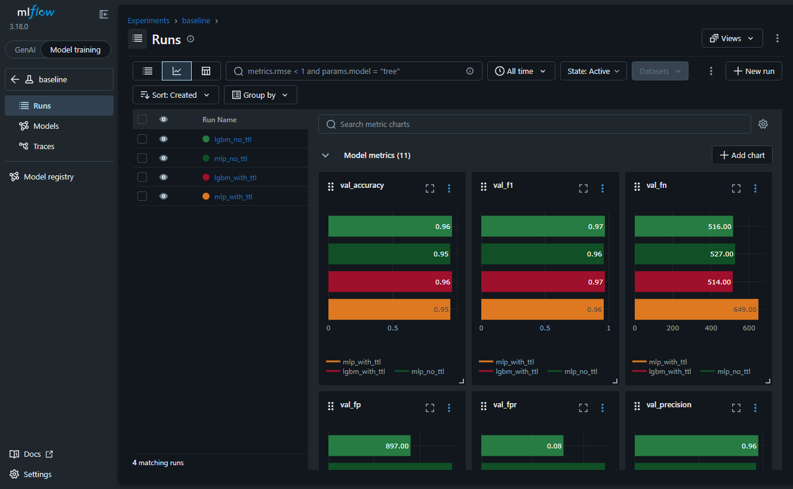
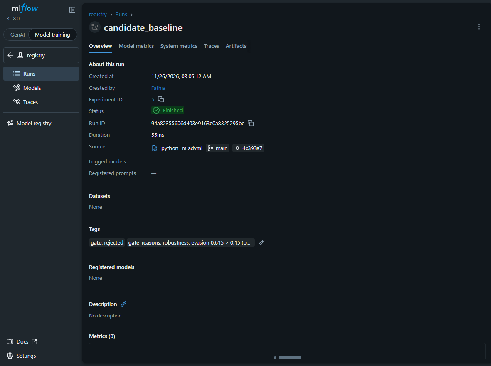
</p>
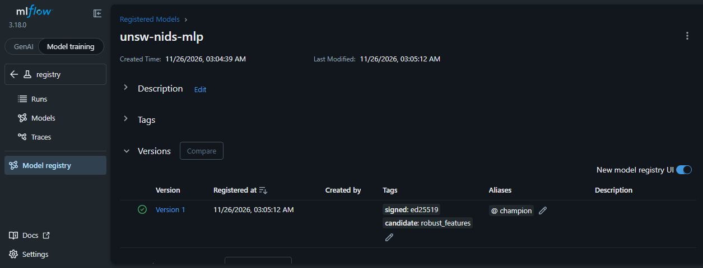

## Final test (official UNSW-NB15 testing set, run once)

Everything above was decided on a validation split carved from the training set. The official testing set was
used once at the end; `python -m advml final` refuses to run a second time.

| Model | Recall | False positives | Accuracy | Evasion, both ends, +25% / +100% |
|---|---|---|---|---|
| Baseline MLP | 98.6% | 31.4% | 85.1% | 52.2% / 64.6% |
| Adversarial training | 99.1% | 38.6% | 82.2% | 0.1% / 0.2% |
| **Released (robust features)** | **97.1%** | **28.8%** | **85.5%** | **0% / 0%** |

The robustness results hold on unseen data. False positives roughly double for every model: the testing set's
normal traffic has a different mix (74% of normal flows without an identified service vs 65%, more INT and REQ
connection states) and a lower attack share (55% vs 68%). This is a property of the dataset split, not of the
defenses; it was reported, not tuned away.

## Mapping

Every attack and defense is mapped to MITRE ATLAS (2026.07) and the OWASP Machine Learning Security Top 10 in
[docs/threat-mapping.md](docs/threat-mapping.md): AML.T0015 Evade AI Model, AML.T0043 Craft Adversarial Data,
AML.T0020 Training Data Poisoning, AML.T0018 Manipulate AI Model, AML.T0010.003 AI Supply Chain Compromise: Model,
AML.T0011.000 Unsafe AI Artifacts; mitigations AML.M0003, M0007, M0011, M0013, M0014, M0015, M0016, M0025.

## Run it

```bash
pip install torch==2.15.0 --index-url https://download.pytorch.org/whl/cpu
pip install -r requirements.txt && pip install -e .
pytest                                  # 40 tests, synthetic data, seconds
python -m advml baseline                # downloads UNSW-NB15 (47 MB, hash-checked), trains MLP + LightGBM
python -m advml evasion                 # paper vs constrained attacks, importance
python -m advml poisoning               # label flipping, backdoor, five detectors
python -m advml defenses                # adversarial training, robust features, ensemble
python -m advml supply_chain            # malicious pickle demo, signing, tamper tests, gate, registry
python -m advml final                   # official test set, once
python -m advml.figures                 # README figures from results/*.json
python -m advml.verify models/release --gate
python -m advml.score --sample 4 --attack   # score flows with the verified release
mlflow ui --backend-store-uri sqlite:///mlflow.db
```

CPU only; the whole pipeline takes about 15 minutes on a laptop. Seeds are fixed and a rerun reproduces the
numbers above. The signing private key is generated locally on first run and never committed; `keys/` holds only
the public key.

## Layout

```
src/advml/
  data.py          download + hash check, preprocessing (NumPy and differentiable PyTorch), splits
  models.py        MLP, masked MLP, training loop (with adversarial-training hook), metrics
  attacks.py       threat models, constrained PGD, black-box search, ART FGSM / PGD / HopSkipJump
  validation.py    "is this a real flow" checks
  poison.py        label flipping, backdoor, trusted core set, spike check, ART activation clustering
  defenses.py      adversarial training, robust feature mask
  supply_chain.py  malicious checkpoint demo, ModelScan, Ed25519 manifests, verified loading, gate
  verify.py, score.py  command lines: verify a model folder; score flows with the verified release
  store.py         safetensors + JSON persistence
  stages/          one module per milestone, each writes results/<stage>.json
results/           metrics (JSON) and figures
models/release/    the released, signed model
docs/              threat mapping, screenshots
tools/             screenshot tooling (headless Edge)
```

## Limitations

- The attacks change flow features, not packets; a full replay through a real sensor (e.g. Argus/Zeek) would be
  the next step to confirm problem-space realism end to end.
- Connection counters (`ct_*`) are treated as out of the attacker's reach; an attacker who opens many extra
  connections could shift them.
- UNSW-NB15's official train/test split has a known distribution shift, visible in the false-positive rate.
- No privacy attacks (membership inference, model inversion, extraction).

## Data

UNSW-NB15, N. Moustafa and J. Slay, MilCIS 2015. Free for academic research; not redistributed here (see
[data/README.md](data/README.md)).

## License

MIT
